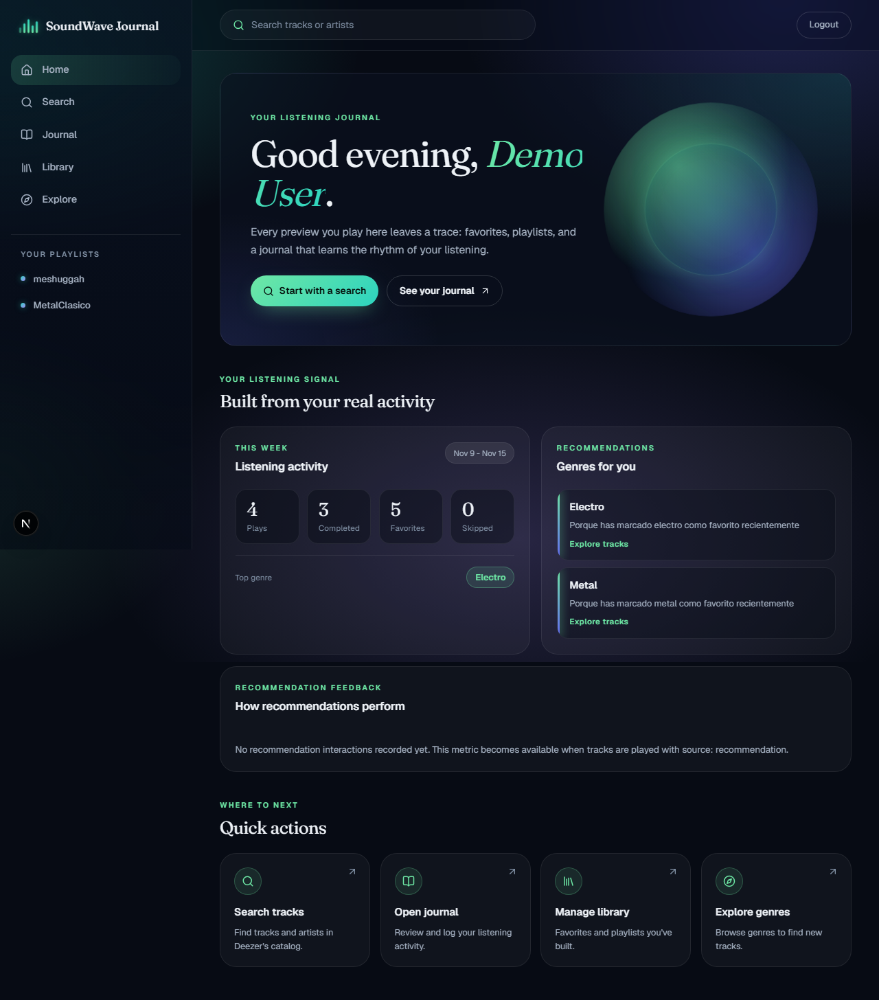
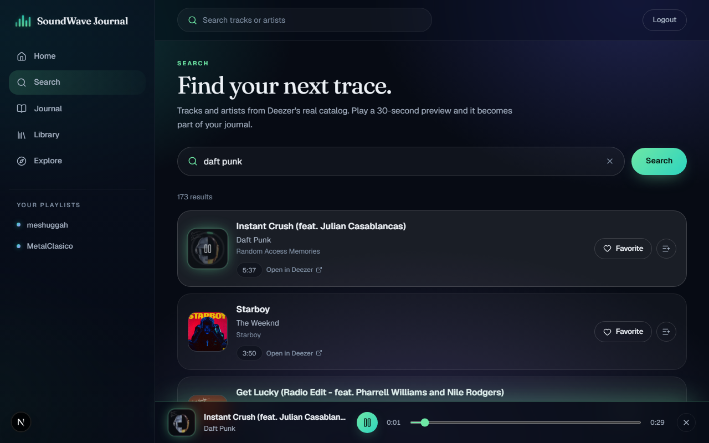
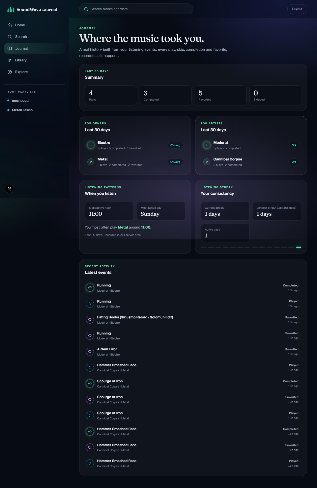
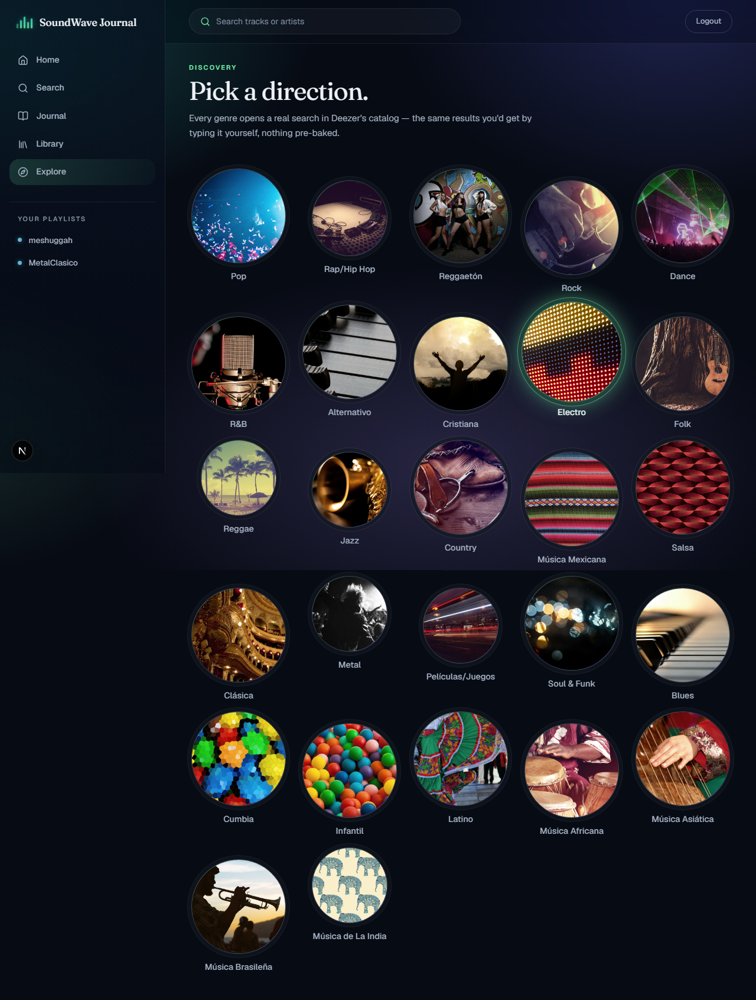
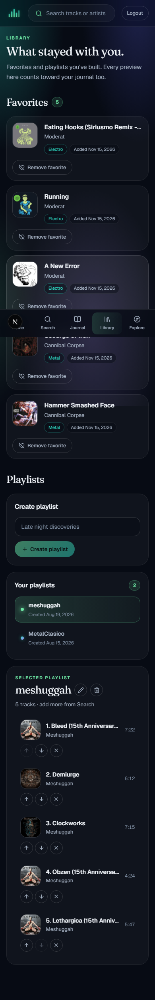

# SoundWave Journal

A music discovery and listening-analytics app built on real data: real search results and previews from Deezer, real listening events, and recommendations derived from that history — not a static demo with hardcoded cards.

> **Live demo:** not deployed yet. The app runs fully locally (see [Local setup](#local-setup)); production deployment is pending a domain decision (same-site subdomains for `app.*` / `api.*`, required for the refresh-token cookie to survive cross-origin — see [Known limitations](#known-limitations)). Once deployed, see [`docs/DEMO_GUIDE.md`](docs/DEMO_GUIDE.md) for credentials and a scripted walkthrough.

| Home | Search with the preview player |
|---|---|
|  |  |

| Journal | Discovery | Mobile |
|---|---|---|
|  |  |  |

More in [`docs/screenshots/redesign/`](docs/screenshots/redesign/) (every view, desktop and mobile).

## What it does

- **Search** real tracks via a Deezer-backed proxy, with 30-second previews.
- **Preview player**: one shared player for the whole app. Play from Search, Library or a playlist; a now-playing bar with scrubbing keeps playing while you navigate between sections.
- **Favorites** and **Playlists** (create, rename, delete, add/remove tracks, reorder with paginated Move up/down controls that stay correct across page boundaries).
- **Journal**: a real history of play/skip/complete/favorite events, with weekly summary, top genres/artists, recent activity, listening-pattern panels (most active hour/day, top genre-by-hour), and listening streaks.
- **Recommendations**: explainable genre suggestions derived from the user's own event history (not ML), with a feedback loop (`source: "recommendation"`) that measures whether suggestions actually get favorited/completed.
- **Discovery**: browse real Deezer genres, each linking into a real Search query — no separate fake "trending" feed.
- **Developer diagnostics** (`/developer`): a live view of rate-limit consumption per policy. It's explicitly a diagnostics mirror, not the enforcement mechanism itself (see [Rate limiting](#rate-limiting-real-enforcement-vs-diagnostics)).
- **Responsive, accessible interface**: a single dark design system ("Deep Listening") built on CSS custom properties. The sidebar becomes a bottom tab bar under 1024px, text colours meet WCAG AA, and all motion stops under `prefers-reduced-motion`.

## Architecture

Two-package monorepo, no shared workspace tooling beyond convenience scripts at the root:

```
apps/
  web/   Next.js 16 (App Router), TanStack Query, CSS Modules on design tokens (Tailwind v4 theme)
  api/   Express 5 + TypeScript, Prisma 7, PostgreSQL
```

The frontend never talks to Deezer directly — every external call is proxied through the API, which also owns metadata resolution, rate limiting, and auth.

### Preview player

A single hidden `<audio>` element lives in a provider mounted in the authenticated layout, so playback survives client-side navigation; every cover in Search, Library and playlists is a play/pause control with a progress ring, and the now-playing bar reads the same state. Playback progress sits in its own React context so the ~4 updates per second re-render only the active cover and the bar. `PLAY` and `COMPLETE` events are logged from here with the surface they came from (`search`, `recommendation`, `favorite`, `playlist`).

Deezer preview URLs are signed and expire within minutes (`?hdnea=exp=…`), so the copies stored with favorites, playlist tracks and `track_metadata` go stale quickly. Rather than re-resolving every row on each listing, the player checks the token's `exp` right before `play()`; only when it has passed does it call `GET /tracks/:id/preview`, which returns a valid URL (from the user's metadata if still fresh, otherwise from Deezer) and persists it to the user's metadata, favorites and playlist tracks. Listings stay free of Deezer calls, a play costs at most one, and a fresh URL is set and played synchronously inside the user gesture on Safari/iOS. `PLAY` is logged only once audio actually starts, so a dead preview never counts as a listen.

### Auth flow

- **Access token**: short-lived JWT, kept in memory on the client (not `localStorage`) via a Zustand store.
- **Refresh token**: `httpOnly`, `Secure` (in production), `SameSite=Strict` cookie, rotated on every use and revocable server-side (`RefreshSession` table with hashed tokens).
- On app load, `AuthBootstrap` calls `/api/auth/refresh` using the cookie to silently resume the session, then `/api/auth/me`.
- Axios request/response interceptors retry a `401` once after a silent refresh. Login, register, refresh and logout are excluded: a `401` from those is the answer itself, and retrying would replace "Invalid credentials" with the refresh error.
- Multiple browser tabs coordinate that refresh through the Web Locks API (`navigator.locks`), so two tabs don't race to rotate the same refresh token and knock each other's session out.
- A protected route visited without a session redirects to `/login?next=<path and query>`, and a successful login or registration returns there. `next` only accepts same-origin absolute paths (`//host`, `/\host`, full URLs and the auth pages themselves fall back to Home), so it can't be used as an open redirect.
- Nothing waits forever: API calls time out (15 s, refresh 8 s), and a tab waits at most 10 s for the refresh lock. If the holder is frozen or orphaned, the waiting tab refreshes on its own instead of staying on "Restoring your session".

### Rate limiting: real enforcement vs. diagnostics

Two independent things, deliberately not the same store:

1. **Enforcement** — `express-rate-limit`, fixed-window, **in-memory, per-process**. Policies: `authWrite` (10/15min), `refresh` (30/15min), `public` (60/min), and a separate userId-keyed `activityWriteLimiter` (120/min) for authenticated writes (favorites, playlists, journal events). This is what actually returns `429`s.
2. **Diagnostics** (`/developer`) — a second, separate bookkeeping `Map` that mirrors the IP-keyed policies (not the userId-keyed one) purely to expose current usage per policy. If this dashboard disagreed with reality, requests would still be correctly limited — it's an observer, not the source of truth.

Known limitation: the in-memory store doesn't survive multiple instances. Scaling horizontally requires a shared store (Redis) — documented, not yet implemented, since the MVP runs as a single process.

### Discovery → Search, not a separate catalog

`GET /discovery/genres` proxies Deezer's genre list. Picking a genre tile navigates to `/search?q=<genre>` — it reuses the real search endpoint with no `source=recommendation` tag, since genre browsing is general catalog navigation, not a personalized recommendation (tagging it would have polluted recommendation-effectiveness metrics).

## Testing & CI

End-to-end coverage runs against the real backend and a real Postgres database — only `/api/search` (and occasionally `/api/discovery/genres`) are network-mocked at the Playwright level, specifically to stay deterministic and Deezer-independent. Nothing about auth, playlists, favorites, or journal persistence is mocked.

| Spec | Covers |
|---|---|
| `auth.setup.ts` | Not a spec: logs the fixture user in once through the API and saves the session cookie |
| `auth-session.spec.ts` | Register, reload-session restore, logout, log back in through the form |
| `favorites-flow.spec.ts` | Mocked search → real favorite → real Library |
| `playlist-flow.spec.ts` | Create playlist → add track from (mocked) Search → verify in Library → remove |
| `playlist-move-flow.spec.ts` | Seeds 13 tracks directly via API, moves a track across the pagination boundary (page 1 ↔ page 2) |
| `playlist-manage-flow.spec.ts` | Create playlist → rename → delete, verified in both the sidebar and the detail view |
| `discovery-flow.spec.ts` | Mocked genres → navigates into a real Search query |
| `journal-patterns-flow.spec.ts` | Mocked journal endpoints → renders time-pattern and streak panels |

Only `auth-session.spec.ts` goes through the login and register forms. Every other spec needs to *be* logged in, not to test logging in, so it starts from a saved session (`tests/session.ts`) instead of spending one of the 10 login attempts per 15 minutes that `authWrite` allows. Because the API rotates the refresh token on every use and rejects the previous one, a fixed saved state would die after the first page load; each test hands its rotated cookie to the next, which is one of the reasons the suite runs with a single worker.

A dedicated fixture user (seeded by `apps/api/src/scripts/seed-e2e-fixtures.ts`) is reset before each run so the suite is idempotent — running it twice back to back produces the same result, no accumulating rows. The seed script refuses to run unless `NODE_ENV=test` **and** the parsed `DATABASE_URL` database name is exactly `soundwave_journal_test`, so it can't accidentally wipe a dev or production database.

CI (`.github/workflows/ci.yml`) runs on every push/PR: spins up an ephemeral Postgres service container, applies migrations, seeds the E2E fixtures, typechecks and builds both packages, then runs the full Playwright suite headless.

```bash
cd apps/api && npm run seed:e2e
cd apps/web && npm run test:e2e   # expects "8 passed" (7 specs + the session setup)
```

The suite runs in Chromium by default (that is what CI runs). It also passes in WebKit and Firefox; run them locally with `E2E_BROWSERS=webkit npm run test:e2e` (or `firefox`), reseeding before each engine because the specs share one fixture user. Specs locate elements by accessible name, never by CSS class; [`docs/UI_DOM_CONTRACT.md`](docs/UI_DOM_CONTRACT.md) lists the names and structure they rely on, which is what allowed the whole interface to be restyled without rewriting the tests.

Both commands need `DATABASE_URL` (pointing at `soundwave_journal_test`), `JWT_ACCESS_SECRET` and `JWT_REFRESH_SECRET` in the environment, and the seed additionally needs `NODE_ENV=test`. Locally you can keep the three variables in `apps/web/.env.e2e` (gitignored): the Playwright config loads that file for any variable not already set, which also makes the VS Code Playwright extension work. CI sets them explicitly.

## Environment variables

### `apps/api/.env`

| Variable | Required | Effect if missing |
|---|---|---|
| `NODE_ENV` | Yes (`development` \| `test` \| `production`) | Process refuses to start — fails closed, never defaults silently. |
| `DATABASE_URL` | Yes | Prisma fails on first query. |
| `JWT_ACCESS_SECRET` | Yes | Auth endpoints 500. |
| `JWT_REFRESH_SECRET` | Yes | Refresh/logout fail. |
| `PORT` | No (default `3001`) | — |
| `FRONTEND_URL` | No (default `http://localhost:3000`) | CORS only allows the default origin — **must** be set to the real frontend origin in production. |

### `apps/web/.env`

| Variable | Required |
|---|---|
| `NEXT_PUBLIC_API_URL` | Yes — base URL the frontend calls, e.g. `http://localhost:3001/api`. Also required at **build** time: static prerendering evaluates the API client module, which throws if this is unset. |

## Local setup

```bash
# API
cd apps/api
cp .env.example .env   # fill in DATABASE_URL, JWT secrets
npm install
npx prisma migrate dev
npm run dev            # http://localhost:3001

# Web (separate terminal)
cd apps/web
cp .env.example .env   # NEXT_PUBLIC_API_URL=http://localhost:3001/api
npm install
npm run dev            # http://localhost:3000
```

E2E tests run against an isolated `soundwave_journal_test` database on dedicated ports (3100/3101) so they never collide with a running dev server — see `apps/web/playwright.config.ts`.

## Known limitations

Documented deliberately, not discovered by accident:

- **Rate limiting is in-memory and per-process** — correct for a single instance, not for horizontal scaling (needs Redis).
- **No production deployment yet** — blocked on choosing a domain for same-site `app.*`/`api.*` subdomains, required because the refresh cookie is `SameSite=Strict` and (schemeful) same-site rules mean both must also serve over HTTPS.
- **Discovery has no independent track feed** — genre tiles route into Search; there's no chart/recommendation-by-genre backend yet (deliberately deferred, not an oversight).
- **The player has no queue** — it plays one 30-second preview at a time and keeps playing across client-side navigation, but there is no next/previous track or autoplay, and a full page reload stops it.- **Playlist visibility/sharing is incomplete**: the backend accepts `isPublic` when creating a playlist, but the frontend has no visibility control, no toggle after creation, and no route generates or consumes a `shareToken`.
- **No public profile / playlist sharing UI**, despite the schema supporting it.
- **A demo account seed script exists** (`apps/api/src/scripts/seed-demo-account.ts`) but is intentionally locked behind a production-database allowlist and an explicit confirmation env var — it will refuse to run until those are set after the production database exists.
